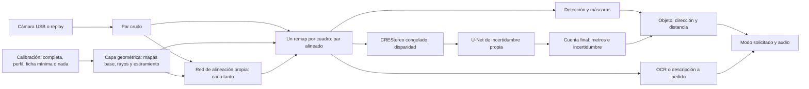

# VisionX — qué queremos construir y qué falta hacer

Actualizado: **18 de noviembre de 2026**, por el pivote de T12 a «CREStereo adaptable»
([nota del 18/11](VisionX_Nota_Bauty_CREStereo.pdf)). Material interno para Tomás, Bauty y
sus agentes.
Entrega académica: **10 de diciembre de 2026**, confirmada por Tomás. La nota del 18/11
menciona congelar el 4/12, entrega el 7/12 y exposición el 12/12: esa diferencia está
**pendiente de confirmar** y no cambia la fecha oficial.

Este archivo contiene el plan y el estado de las tareas. [TECNICO](TECNICO.md) explica cómo
funciona cada parte. [BITACORA](BITACORA.md) cuenta lo que pasó realmente, con evidencia,
problemas y decisiones. No hay que buscar fichas ni índices A/B en otras carpetas.

## Cómo leerlo

1. [Objetivo y alcance](#objetivo-y-alcance): para qué existe el proyecto.
2. [Estado real](#estado-real): qué está disponible y qué todavía es futuro.
3. [Recorrido y decisiones](#recorrido-y-decisiones): cómo se conecta todo.
4. [Etapas](#etapas): qué debe funcionar primero y qué se agrega después.
5. [Tareas](#tareas): una tabla de estados y veinte bloques con entregables.
6. [Organización del trabajo](#organizacion-del-trabajo): cómo paralelizar sin pisarse.
7. [Correspondencia anterior](#correspondencia-anterior): dónde quedó cada ID viejo.

## Objetivo y alcance

VisionX busca ayudar a una persona con baja visión a **encontrar un objeto, orientarse hacia
él, consultar su distancia, leer texto y entender qué tiene enfrente mediante audio**.
El dashboard, una pantalla de diagnóstico, es para nosotros y para explicar la demo;
el usuario no necesita mirarlo.

Desde el 18/11 la investigación central es **CREStereo adaptable** (decisión de Bauty después
de hablar con el profesor; diseño en [TECNICO](TECNICO.md#crestereo-adaptable)). Se toma
CREStereo, una red de estéreo preentrenada que queda congelada, y se la envuelve con dos redes
propias: una **red de alineación** antes y una **U-Net de incertidumbre** después. No se busca
mejorar la precisión de CREStereo, sino hacerla más útil: que reciba el par crudo de una cámara
estéreo y devuelva profundidad en metros con incertidumbre, en varias cámaras. Hoy es **solo
planificación**: no hay código, pesos ni mediciones de este sistema.

Criterio de éxito, escrito antes de medir. Con calibración buena: igualar a «rectificación con
OpenCV + CREStereo»; empatar es lo correcto, es un control de no empeorar. Con calibración
imperfecta o incompleta: degradarse menos que ese camino; esa curva de robustez es el resultado
principal. Frente al método clásico de autorrectificación con correspondencias: empatar o ganar
en precisión o en tiempo; si pierde, la red de alineación no se justifica y queda el clásico.
No es «sin calibrar»: es corrección en línea alrededor de un perfil de cámara conocido, más un
camino degradado para cámaras desconocidas. No sabemos todavía si ganará: medir y explicar un
resultado negativo también forma parte del trabajo científico.

Reemplaza como investigación central a **SpatialDepth-Fusion**, la CNN propia que combinaba el
estéreo clásico (SGBM) con la monocular preentrenada Depth Anything V2 Small. Fusion ganó en
InStereo2K val, pero fuera de dominio empató con la regla fija B5 (BITACORA 2026-11-17). Queda
como resultado negativo documentado y como comparador; no se borra.

**Alcance completo comprometido:** cuatro modos USB; evaluación contra cuatro modelos
preentrenados; CREStereo adaptable; Fusion, ahora como comparador; incertidumbre; Lite mediante
destilación; Fusion-FFS; portátil con Raspberry/batería y alerta de cercanía. Lite y Fusion-FFS
se redefinen sobre la base nueva (maestro CREStereo; FFS como estéreo de base alternativo):
decisión pendiente de Bauty. La entrega de diciembre prioriza USB, CREStereo adaptable y
evaluación. Lo restante continúa después si no está aceptado; no se elimina por ser dos personas.
SLAM y memoria persistente de objetos siguen fuera del alcance acordado: no construiremos
un mapa acumulado ni diremos dónde quedó algo que ya no está visible.

## Estado real

Foto de la base publicada al iniciar esta revisión: `526facc`, PR #11 integrado.
La reorganización actual es **solo documental**; no instala funcionalidades futuras.

| Disponible | Evidencia y límite |
|---|---|
| Entorno Python/uv, CI y protección de main | Registros Windows/Mac del 28/10; no equivalen a una demo |
| Contratos y geometría compartida, schema 3 | PR #10 `d8a38bd`: validación, offsets, recortes, arrays estables |
| Configuración distribuida y diagnóstico | PR #11 `526facc`: wheel, overrides explícitos y pruebas de instalación |
| Tests del núcleo | Resultado histórico conjunto: 197 aprobados en Windows; no se reejecutaron para esta planificación |
| Cámara ELP | Tomás confirmó que el módulo está en nuestras manos; aún falta evidencia de captura/calibración aceptada |
| Mac de demo | Bauty registró M2 Max/32 GB y MPS disponible; falta medir el pipeline real |
| Almacén Drive | Ubicación definida; falta confirmar recepción del archivo/hash de prueba desde Mac |

**Todavía no aceptados en main:** replay y fakes de producción, aplicación, captura/calibración
real, detector, voz, OCR, descripción, B0–B4, CNN entrenada, comparadores y portátil.
Los ejemplos de fakes dentro de tests no constituyen esos módulos terminados.
El intento local adelantado por Codex no se incorpora: fue detenido por Tomás al aclarar
que el pedido era planificación. No cuenta como avance aceptado.

La cátedra aprobó el equipo, el tema y el formato (informado por Bauty, BITACORA 2026-11-13).
Formato de trabajo: informe total de hasta ocho páginas y póster vertical A0/A1.

## Recorrido y decisiones

Una imagen estéreo contiene dos vistas simultáneas. La captura las separa y la calibración
las lleva a una geometría conocida. Desde ahí se ejecutan profundidad y detección.
El diagrama muestra el flujo **previsto** desde el pivote del 18/11; todavía no existe en código:

El flujo anterior (SGBM y Depth Anything alineados, combinación fija B4 y Fusion) sigue en el
código como comparador. SGBM (B0) queda además como respaldo previsto del modo continuo si
CREStereo no entra en la compuerta de latencia (ver [T12](#tareas)).

Una máscara señala los píxeles de un objeto. Sirve para medir su superficie y evitar tomar
el fondo dentro de una caja. La política por objeto decide entre metros, dirección,
reencuadre o abstención. El VLM, modelo que interpreta imagen y lenguaje, puede enriquecer
una descripción; las distancias siempre salen de las mediciones estructuradas.

| Tema | Decisión de trabajo y motivo | Alternativa y qué la decidiría |
|---|---|---|
| Aplicación | Monolito modular: una aplicación con partes separadas; fácil de ejecutar y seguir | Más procesos solo si una medición demuestra necesidad; no microservicios por rutina |
| Estéreo de base | Desde el 18/11: CREStereo preentrenado (`crestereo_eth3d`) y congelado, sin tocar ninguna capa; previsto, sin medir en MPS | Otro estéreo de base, o un alumno destilado (T17 con CREStereo como maestro), si la compuerta de latencia no da; el modo continuo usaría B0 sobre el par corregido |
| Alineación | Red propia antes de CREStereo: estima roll, pitch, yaw y razón de focal con confianza, cada tanto y en segundo plano | Método clásico con correspondencias (SIFT/ORB, RANSAC) como comparador obligatorio y respaldo; si la red no empata o gana en precisión o tiempo, queda el clásico |
| Cámaras soportadas | Cuatro niveles: cámara propia (muy bueno); otra unidad ELP con el perfil incluido (relativamente bueno); cámara distinta con datos (aceptable, con metros); cámara distinta sin datos (modo relativo, sin metros) | La escala no sale de las imágenes: la da un dato o una distancia conocida. Fuera de alcance: ojo de pez y ojos no sincronizados. El chequeo «¿conozco esta cámara?» hay que medirlo con una cámara distinta real |
| Monocular | Depth Anything V2 Small sale de la app con el pivote del 18/11; sigue en los comparadores B4, B5 y Fusion | Monocular métrica solo como experimento exploratorio de escala sin datos; no asumir que reemplaza calibración |
| Fusión | Reemplazada el 18/11: la U-Net residual sobre B4 (F0/F1/F3) queda como resultado negativo y comparador. La red propia de salida pasa a ser una U-Net de incertidumbre (b de Laplace) que reutiliza su infraestructura | Chequeo izquierda-derecha como comparador obligatorio de la incertidumbre; corrección de disparidad Δd solo como ablación |
| Ejecución | Interactivo y comparación científica separados | El interactivo prioriza actualidad; la comparación procesa los mismos pares sin descartarlos |
| Resolución | Medir 640×360, 960×540 y 1280×720 por ojo | Elegir por precisión/cobertura/latencia, no por el preset del YAML |
| Detección | Evaluar YOLO26n-seg y referencia YOLO11n-seg | Modelo mayor si ayuda a objetos pequeños; YOLOE para categorías nuevas con máscaras |
| Voz | Botón + órdenes explícitas; STT local y TTS local | MLX Whisper en Mac, faster-whisper CPU/CUDA según equipo; comparar frases reales |
| OCR | Evaluar RapidOCR/ONNX con soporte de español | Otra implementación si CER, números o latencia no alcanzan |
| Descripción | Plantilla local más VLM a pedido | Proveedor/modelo remoto no elegido; evaluar respuestas, timeout, coste y fallback |
| Portátil | Raspberry captura, transmite y reproduce audio; computadora procesa | Migrar más cómputo al dispositivo solo con evidencia de energía y velocidad |

Estas opciones son candidatos de planificación. No se afirma que ya estén instaladas,
comparadas ni que alguna versión garantice mejor rendimiento.

## Etapas

Una etapa indica una capacidad demostrable. Los números no obligan a esperar todo lo anterior
para empezar: voz puede avanzar con ejemplos; los comparadores con pares públicos; la app con fakes.

| Etapa | Resultado que permite avanzar |
|---|---|
| Base reproducible | Leer el mismo par en Windows/Mac y generar salidas simuladas consistentes, con IDs y errores claros |
| USB clásico | Cámara calibrada, SGBM y metros con referencia física; audio/cancelación básicos |
| Cuatro modos base | Buscar/guiar, distancia, leer y describir por USB; pueden empezar con proveedor clásico |
| Investigación | Datos y protocolo fijados; B4, B5 y Fusion entrenada como comparadores; CREStereo adaptable (alineación e incertidumbre) con su curva de robustez, ablaciones mínimas y cuatro comparadores (papel de T14 pendiente de decisión) |
| Entrega académica | Cuatro modos con CREStereo adaptable integrado, o su respaldo según el orden de caída de T12; evaluación trazable, informe, póster y respaldo offline |
| VisionX completo | También Lite y Fusion-FFS (redefinidas sobre la base nueva, decisión pendiente), portátil y alerta con sus pruebas; no se tilda al cerrar diciembre |

### Base y pulido de los cuatro modos

| Modo | Primera versión funcional | Luego, sin cambiar el objetivo |
|---|---|---|
| Buscar/guiar | Clase, presencia, bip, dirección y cancelar | Varios iguales, elección de instancia, tracking, pérdida/reaparición y atributos |
| Distancia | Congelar par y responder metros o abstenerse | Política por objeto, rangos, intervalos y redondeo calibrados |
| Leer | Elegir frame y leer bloques cancelables | Nitidez, encuadre, números, CER y recuperación de errores |
| Describir | Plantilla local con hechos medidos | VLM a pedido, respuesta breve, control de afirmaciones y fallback sin red |

No exigir profundidad fiable para avisar que un objeto fue detectado. No confundir una
demostración simulada con una versión funcional aceptada sobre hardware.

### Calendario objetivo

| Fecha de 2026 | Salida buscada; todavía no es evidencia |
|---|---|
| 2–5 noviembre | Cerrar planificación; base/replay, captura/calibración inicial y preparación de datos/comparadores |
| 6–12 noviembre | USB clásico, cuatro modos base y protocolo fijado |
| 13–19 noviembre | Piloto/overfit, entrenamiento Fusion y ejecución de comparadores |
| 19–21 noviembre | Compuerta de latencia: wrapper de CREStereo en MPS y tabla de latencia (640×352, 960×544 y 1280×720; 2, 4 y 10 iteraciones; una y dos pasadas; arranque en caliente). Estimador clásico; curva de CREStereo sin adaptar perturbando la calibración en clips crudos ELP; CREStereo sobre `cinta-s7` contra B0/B5/Fusion. Acá se decide si CREStereo queda como base |
| 22–26 noviembre | Generador de perturbaciones con yaw y cámaras virtuales; red de alineación |
| 27–30 noviembre | U-Net de incertidumbre; integración en `DepthEstimator` |
| 1–3 diciembre | Evaluación entre cámaras, banco ELP y ablaciones mínimas |
| 4 diciembre | Congelar |
| 5–9 diciembre | Correcciones verificadas, tres ensayos y respaldo (sin cambios por el pivote) |
| 10 diciembre | Entrega académica. La nota del 18/11 dice entrega 7/12 y exposición 12/12: pendiente de confirmar |
| Continuidad | Capacidades pendientes del alcance completo, con nuevas fechas basadas en evidencia |

Las filas desde el 19/11 se reemplazaron el 18/11 por el pivote de T12. Antes decían: 20–26/11
«Integración, ablaciones, incertidumbre y fallos»; 27/11–3/12 «Test reservado, reproducción
cruzada, tablas e informe»; 4–9/12 «Correcciones verificadas, tres ensayos y respaldo», que se
conserva del 5 al 9. El test público reservado para B5 y Fusion (decisión del 17/11), la
reproducción cruzada, las tablas y el informe siguen en T15/T16; todavía no tienen fecha nueva
en este calendario y su ventana anterior se superpone con el trabajo de T12.

Si una fecha falla, registrar causa, impacto y nuevo paso en BITACORA. Una demora no convierte
una capacidad en descartada ni autoriza afirmar que se probó algo que no se hizo.

## Tareas

Esta es la **única tabla de estado**. Los bloques siguientes describen el alcance; no duplican
estados. A=Bauty y B=Tomás son responsables de integración, no los únicos posibles ejecutores.
Para evitar esperas falsas, cada bloque distingue inicio con ejemplos de aceptación real.

Estados: **pendiente**, **en curso**, **parcial**, **por integrar**, **bloqueada**, **hecha**.
Una tarea bloqueada debe tener causa y próximo paso en BITACORA. Hecha requiere evidencia;
si hay código integrado pero falta recepción, escribir ambos hechos sin ocultar disponibilidad.

| ID | Capacidad | Integra | Estado al 02/11 | Reserva activa |
|---|---|---|---|---|
| T01 | Base reproducible, contratos y artefactos | A+B | Parcial: base publicada; recepción/almacén y utilidades pendientes | Ninguna |
| T02 | Captura USB, grabación y replay | B | Hecha: captura, grabación, replay y rectificación (PR #17); M2 con la ELP en Mac: 10 min, 52 fps guardados, 31 256/31 256 pares íntegros, 2,7 % descartados, memoria estable 500–780 MB; 12 clips de desarrollo en Drive (BITACORA 2026-11-14). ELP en Windows sin probar | Ninguna |
| T03 | Calibración y validación física | B con evaluación A | Hecha: calibración s6 (PR #13) + corrección de disparidad 0,5275 px verificada con cinta 1–3 m (control 1,5 m: −5 mm), `configs/calib/elp-2026-11-11-corregida.yaml` (BITACORA 2026-11-13). Estabilidad de δ entre días asumida, no medida. Con el pivote del 18/11 esta calibración pasa a ser el perfil ELP previsto en T12 | Ninguna |
| T04 | Datos, GT, particiones y protocolo | A con capturas B | Parcial: datos públicos integrados (PR #16): MiddEval3-H, ETH3D e InStereo2K (1221 de 2050 pares: part1/5/6 no disponibles) auditados y con manifiesto; protocolo y partición por tramos fijados (BITACORA 2026-11-13). El banco ELP de 40 escenas se reemplazó el 22/11 por la medición con cinta grabada de la prueba A (PLAN-CIERRE, sección 6, paso 4): una sesión en dos lugares, 10–15 objetos, sin test físico reservado. Lugar 1 grabado el 23/11 (`banco-s1-e01`, 7 stickers, `bench evaluar` probado de punta a punta con tablero y con perfil; BITACORA 2026-11-23); falta el lugar 2 (Bauty; rama de la decisión `a/T04-cinta-en-a`, que además agrega `bench evaluar --camara <perfil>` y rangos hasta 4 m: `src/visionx/depth/bench.py`, `tests/test_depth_bench.py`). Pivote 18/11: datos públicos con imágenes crudas de otras cámaras (KITTI raw, EuRoC, Middlebury 2014 `imperfect`) a confirmar; clips ELP de desarrollo, nunca las sesiones reservadas, previstos para entrenar la alineación | Ninguna |
| T05 | Estéreo, monocular, alineación y B0–B4 | A | Hecha con software: B0–B4 (PR #21, #22), ajuste en InStereo2K val, parámetros congelados, test público una vez y latencia M9 en Mac (PR 3). En MiddEval3, B4 pierde contra B0. Pendiente con el banco ELP (T04): umbrales de alineación a 1280×720 y `min_coverage` (BITACORA 2026-11-14). Pivote 18/11: B0 queda como comparador y respaldo previsto del modo continuo; B4 como comparador «antes», fuera de la app | Ninguna |
| T06 | Detección, máscaras y seguimiento | B | Parcial: código integrado (PR #18): YOLO-seg, IDs ByteTrack, fake, catálogo en español y CLI, con tests sin cámara. Sobre clips ELP rectificados (BITACORA 2026-11-14): máscaras sobre el par rectificado revisadas a ojo en un cuadro; con cámara en mano el ID no sobrevive a la reaparición y muchas detecciones quedan sin ID; mochila casi no detectada. Falta: comparación 26 vs 11 en Mac, 3 clips anotados a mano y decidir el ajuste de ByteTrack | Ninguna |
| T07 | Ejecución interactiva/científica y dashboard | B | En curso: integrado en main (PR #24); en PR #27: los modos no avanzan con el botón de hablar apretado, registro de profundidad B0–B5/fusion, profundidad precisa a pedido (`--profundidad-precisa`), recepción de estimadores (`recibir-profundidad`), banco M1 (8 casos ×3, todo PASA, cero audio viejo) y vigencia del hecho en el audio. M9 en la PC de escritorio: detector 200 ms, B0 en la app ~420 ms (61 ms solo), unión ~0,8 s, 2,1 uniones/s; B4 a pedido ~2,2 s no entra en 2 s (BITACORA 2026-11-17). Falta: ELP/voz en vivo en Windows, latencia en la Mac 19/11 (PR #27): avisos de estado de cámara para CREStereo, `crestereo` y `crestereo-preciso` en el registro (probados en CPU contra B0 sobre cinta), `latencias --traza` y guía en vivo `docs/PRUEBA-EN-VIVO.md` (BITACORA 2026-11-19). 19/11 tarde: PR #27 mergeado (`904f412`); app completa con CREStereo sin errores en CPU; guía para la Mac en `docs/PRUEBA-EN-VIVO.md`. Falta la prueba en vivo en la Mac. | Tomás / Claude Code, `b/beta-2`; Tomás / Claude Code + Codex, `b/beta-integracion` (PR #27), `src/visionx/app/`; CPU |
| T08 | Voz, audio y cancelación | B | Parcial: código integrado (PR #19): reglas (62/62 frases escritas), salida con prioridad/cancelación, Piper, faster-whisper y botón, con tests sin dispositivos; bucle con voz sintética 24–38/61 (BITACORA 2026-11-14). Micrófono real (Yeti Nano, Tomás, 61 frases): Whisper small 96,7 % de intención, STT P50 1,35 s; base 78,7 % (BITACORA 2026-11-17). Falta: otra persona, parlantes: frases dichas por personas, latencia y cancelación audibles, AirPods. En PR #27: reglas aceptan «encontré», «descri…», «cuéntame» (bucle small 36→39/61). PC de escritorio: Whisper base 443 ms / small 1392 ms, Piper 141 ms (BITACORA 2026-11-17) 18–19/11: voz Mateo (Edge, es-UY) con Piper de respaldo, caché en disco de 866 frases frecuentes (`voice precalentar`) y síntesis adelantada; preguntas libres al asistente (BITACORA 2026-11-18/19). 19/11 tarde: una sola voz (Mateo, sin respaldo de Piper). | Tomás / Claude Code, `b/beta-2`; en curso Bauty / Claude Code, `a/T08-panel-audio` (panel para elegir micrófono y salida en vivo: `src/visionx/app/audio_panel.py`, `src/visionx/app/__main__.py`, `src/visionx/voice/output.py`, `tests/test_audio_panel.py`; micrófono y salida de la Mac); Ninguna |
| T09 | Buscar/guiar y medir distancia | B con espacial A | En curso: buscar/guiar (con vertical), elegir entre iguales y distancia como modos de T07; detector por defecto yolo26s @960 y ubicación provisoria por capa cercana (BITACORA 2026-11-15). En clips ELP: vaso 0,5 / taza 1,1 / botella 1,0 / bolso 2,9 m contra cinta 0,50/1,00/1,00/3; silla seguida de 2,6 a 0,6 m con «Llegaste»; abstención ante pared. Demos en Drive `demos/t09/`. Ubicación de A entregada en `depth/spatial/` (`build_locator`; mismos metros que la provisoria en los clips con cinta) y adoptada en la app (PR #27); elección entre iguales que sobrevive a la pérdida y distancia con el último objeto pedido (BITACORA 2026-11-17). Falta: M7/M8 con clips anotados (herramientas listas: `python -m visionx.protocolos m7|m8`), latencia en la Mac 19/11 tarde: guía con sonar estéreo (`guide_style: sonar`), «¿cuál?» describiendo los iguales con el asistente y elección «la verde»; distancia con detalle (color, apoyo, costado en cm, altura respecto del cuerpo). Sin probar en vivo. | Tomás / Claude Code, `b/beta-2`; Tomás / Claude Code, rama `b/T09-mejoras` (apilada sobre `b/T09-buscar`, PR #25), `src/visionx/modes/`, `src/visionx/app/` (controlador y `spatial.py`), `tests/test_modes.py`, secciones `modes`/`spatial_provisional`/`detection` de `configs/default.yaml`; CPU |
| T10 | Leer texto | B | Parcial: en PR #27: RapidOCR PP-OCRv5 latin en CPU, frame más nítido, OCR asíncrono y cancelable, orden por regiones, título primero, habla filtrada (precisión de lo hablado 96 %), OCR precalentado y frames previos a la orden: orden → primera palabra 0,9–1,2 s. Lee títulos y leyendas grandes; la letra chica no se recupera (recall de palabras ~10 %, 7 segmentos, n = 1). Herramienta M10 lista (`protocolos ocr`). Falta: 30 textos (M10), audio real y Mac (BITACORA 2026-11-17) 19/11: leer con Claude Sonnet 5.5 (objeto + lo importante, citas verificadas contra el OCR; «leé todo» = lectura por bloques) y preguntas sobre el texto (BITACORA 2026-11-19). 19/11 tarde: lo no escrito se responde como conocimiento general aclarado. | Tomás / Claude Code, `b/beta-2`; Tomás / Codex + Claude Code, `b/T10-leer`, `src/visionx/reading/`, `src/visionx/modes/read.py`, extra `ocr`; CPU |
| T11 | Describir escenas | B | Parcial: en PR #27, plantilla local: agrupada por zona, metros solo medidos, dos niveles de confianza (afirma / «parece haber»), ≤ 8 s. En 7 fases de desarrollo: 27 objetos reales mencionados, 0 sin respaldo (umbrales ajustados en esos mismos clips). Herramienta M10 lista (`protocolos describir`). Falta: 30 escenas anotadas (M10), VLM a pedido, audio real (BITACORA 2026-11-17) 19/11: describir con Claude Sonnet 5.5 en frases naturales con los metros del estéreo; sin red, la plantilla (BITACORA 2026-11-19). 19/11 tarde: frases de ≤ 15 palabras. | Tomás / Claude Code, `b/beta-2`; Tomás / Codex + Claude Code, `b/T11-describir`, `src/visionx/modes/describe.py`, sección `describe`; CPU |
| T12 | CREStereo adaptable: alineación, incertidumbre e integración (reemplaza Fusion) | A con carga B | En curso, replanificada el 18/11 (pivote; BITACORA 2026-11-18). Compuerta del 18/11 (BITACORA 2026-11-18, segunda entrada; PR #32): wrapper y estimador de CREStereo congelado, estimador clásico de alineación, generador de perturbaciones (etapa 1) y mediciones. En MPS, M9 sobre `dev-1114-distancias`: continuo 640×360 con arranque en caliente P50 120 / P95 136 ms (cuadro en frío 218 ms); preciso 1280×720 P50 617 / P95 647 ms. En `cinta-s7` (1–3 m, damero) el preciso erra +1 a +34 mm (≤ 1,1 %) y B0 −88 a +38 mm (≤ 2,9 %); a 640×360 y 960×540 falla desde 2 m sobre el damero. Robustez (8 pares, referencia = la misma red sin perturbar): 0,25° de roll cambian la profundidad 5,3 % de mediana; la corrección exacta la deja en 0,25 % y el clásico de un solo par en ~2 %. **CREStereo queda como base.** Segunda tanda (BITACORA 2026-11-18, tercera entrada; PR #33): el continuo se aparta 3–6 % del preciso en mediana, así que sirve para guiar y los metros salen del preciso; con escenas variadas el clásico acumulado de 8 pares deja 2–4 % contra 0,3 % de la corrección exacta; en los pares reales del precinto, arreglar las filas no arregla la escala y estimar el yaw la lleva de −3,6 % a −0,7 %, con un sesgo de −1 % en una sesión sana. Tercera tanda (BITACORA 2026-11-19): con una regla de decisión, el clásico queda casi en el techo para roll, pitch y focal (0,3–0,6 % contra 0,25–0,43 %) y en ~2 % para yaw; generador de etapa 2 (cámara real contra nominal, con distorsión); al simular otra unidad del mismo modelo, corregir solo giro y focal deja la mayor parte del daño y hace falta incluir centro y distorsión. **Decidido el 19/11:** se hace la red de alineación, apuntada a la corrección densa que el clásico no cubre (BITACORA 2026-11-19). Implementada y entrenada en la Mac (rama `a/T12-red-alineacion`, PR #37): la v2 (45 épocas) le gana al clásico en el error del campo, pero no en profundidad en cámaras hermanas, ni par por par, ni con un campo por cámara (2,2–6,7 % contra 2,0–5,6 %), ni encima del clásico sin reentrenar, que empeora (BITACORA 2026-11-19, noche); **el sistema sigue con el clásico con lente**. Cuarta tanda (BITACORA 2026-11-19, segunda entrada; rama `a/T12-incertidumbre`): U-Net de incertidumbre entrenada (0,98 M de parámetros, InStereo2K): ordena los errores casi como el chequeo izquierda-derecha en InStereo2K, sin superarlo (AUSE 0,276 y 0,291 en dos semillas contra 0,276), y mejor en Middlebury 2014 extra (0,139 contra 0,175, una semilla), sumando 94 ms al modo preciso en lugar de una pasada entera; el estimador ya puede devolver b (`LAPLACE_B`). **En la ELP b está descalibrada** (1–3 px sobre el damero, donde el error real es 0,1 px). Estimador clásico con términos de lente: no mejora los pares reales y ayuda poco en cámaras hermanas simuladas. Evaluador por puntos del banco listo (`depth/bench.py`, PR #36); en cámaras hermanas simuladas, el clásico con lente más una distancia conocida deja 1,3–6 % contra 3–85 % sin corregir. Falta: el banco ELP con stickers para calibrar b, conectar la confianza de la alineación, precisión por objeto, la segunda cámara y la integración. Cerrado en calidad de comparador: Fusion implementada (canales F0/F1/F3, U-Net residual con NLL, caché, entrenamiento, paquete, `FusionEstimator`) y control fijo B5 (PR #28). En InStereo2K val: B4 2,05 / B5 1,80 / candidato F3 sobre B4 1,68 px de EPE, repetido con 2 semillas; latencia M9 en Mac 365 ms a 1280×720 (BITACORA 2026-11-16 y 2026-11-17). Fuera de dominio (`midd2014extra`, 13 pares): B5 le gana a B4 y Fusion empata con B5. Test público reservado para B5 y Fusion en la ventana final (decisión 17/11); no sirve como evidencia del sistema nuevo. De Fusion quedaron sin hacer: medición en la ELP y test una vez (siguen previstos como comparador), ablaciones mínimas y recepción en la app 19/11 (noche): **decisión (a)** de Tomás: la red de entrada estima el campo de corrección (giros + centro + distorsión) hacia la ELP con confianza; si no alcanza, pedir distancia conocida (BITACORA 2026-11-19, «Decisión T12»). | Bauty / Claude Code, ramas `a/T12-alineacion-clasica-y-generador` (PR #34), `a/T12-incertidumbre` (PR #35) y `a/T12-distancia-conocida-y-banco` (PR #36), integradas, y `a/T12-red-alineacion` (PR #37), integrada; en curso `a/T12-gt-alineacion` (fila «hermana corregida» en `gtsynth evaluar`: `src/visionx/depth/crestereo_adapt/align_apply.py`, `src/visionx/gtsynth/evaluar.py`, `variantes.py`, `__main__.py` y sus tests; `data/gt-sintetico-elp/` y `outputs/gtsynth/` fuera de Git). Rutas de T12: `src/visionx/depth/crestereo_adapt/`, `scripts/profundidad/`, `tests/test_crestereo_*.py`, `src/visionx/depth/bench.py`, `tests/test_depth_bench.py`, sección `depth.crestereo` de `configs/default.yaml`, `.gitignore` (`third_party/`), y `docs/ROADMAP.md`, `docs/TECNICO.md` y `docs/BITACORA.md`; GPU/MPS de la Mac, `third_party/crestereo/`, `weights/crestereo/`, `data/cache/crestereo_inc/`, `outputs/crestereo_inc/` y `outputs/profundidad/` (fuera de Git). Kaggle previsto, todavía sin usar. En curso desde el 21/11: `a/T12-camara-net` (E2 de PLUG-AND-PLAY, red que estima la cámara: `src/visionx/depth/camara_net/`, `tests/test_camara_net.py`; GPU/MPS de la Mac y `outputs/camara_net/`, fuera de Git). E2 v1 y v2 entrenadas (BITACORA 2026-11-22): 9,0 % de focal mediana en val y 5–14 % por cámara en `gt-video`; no llega al 2 %, juntar cuadros no ayuda (sesgo por escena) y la b, con un factor medido en val, cubre 81–99 %. Pesos en el Drive `VisionX-Personal/pesos/camara-net/`. v3-auto (rama `a/T12-v3-auto`, BITACORA 2026-11-22, noche Mac): con las etiquetas de la geometría, `gt-video` 12,7 → 11,9 % y HSSD 20,2 → 17,6 %; entrenar más sin etiquetas no cambia nada; con las etiquetas de duda ≤ 5 % (`e3-auto5`) queda igual (11,7 %) |
| T13 | Incertidumbre y política por objeto | A con uso B | Pendiente. Pivote 18/11: usaría la b de Laplace de la U-Net de incertidumbre de T12 y la confianza de la alineación; comparador obligatorio, el chequeo izquierda-derecha 19/11 (noche): definido cómo llega la incertidumbre a la voz (tres niveles, verificación) y el mini dataset con ground truth ([INCERTIDUMBRE-Y-GT](INCERTIDUMBRE-Y-GT.md)). 23/11: el ubicador llena el intervalo del 90 % con `spatial.b_factor` (apagado por defecto) y la U-Net se puede prender solo en el preciso; factor de la ELP 0,6 con la cinta del lugar 1, a comprobar en el lugar 2 (BITACORA 2026-11-23). | Bauty / Claude Code, `a/T13-intervalo-voz` (apilada sobre `a/T04-cinta-en-a`): `src/visionx/depth/spatial/locator.py`, `src/visionx/depth/crestereo_adapt/estimator.py`, `src/visionx/depth/camara_net/grabacion.py` y `__main__.py`, sus tests, secciones `spatial` y `depth.crestereo` de `configs/default.yaml`; `data/real/` y `outputs/autoetiquetas/real*.csv` fuera de Git |
| T14 | Cuatro comparadores preentrenados | A | Pendiente. Pivote 18/11: con CREStereo como estéreo de base cambia su papel; los cuatro siguen en el alcance y qué correr y cuándo es decisión pendiente de Bauty | Ninguna |
| T15 | Evaluación final y reportes | A+B | Pendiente. Pivote 18/11: la evidencia principal pasa a ser el banco ELP con cinta y la curva de robustez; MiddEval3 y ETH3D no sirven para el sistema nuevo y siguen reservados para B5 y Fusion 19/11: la cátedra sugiere un mini dataset con verdad de distancias y etiquetas para medir con más casos que la cinta. | Ninguna |
| T16 | Informe, póster, reproducción y entrega | A+B | Pendiente | Ninguna |
| T17 | Pseudoetiquetas y Lite | A | Pendiente. Pivote 18/11: se redefine con CREStereo como maestro; el alumno destilado es además la alternativa si CREStereo no sirve como base. Decisión pendiente de Bauty | Ninguna |
| T18 | Fusion-FFS | A | Pendiente. Pivote 18/11: se redefine con FFS como estéreo de base alternativo. Decisión pendiente de Bauty | Ninguna |
| T19 | Raspberry, transporte, audio y energía | B | Pendiente | Ninguna |
| T20 | Alerta de cercanía | B con política A | Pendiente | Ninguna |

Los worktrees antiguos B01/B03 no constituyen reservas actuales confirmadas. Consultar a
su ejecutor antes de continuar o retirar sus cambios. El intento C10 de código está detenido.
La reserva documental de esta reorganización se registra en BITACORA; no inicia las veinte tareas.

### T01 — Base reproducible, contratos y artefactos

- **Entrada:** código publicado, entornos Windows/Mac y acceso al Drive compartido.
- **Hacer:** recibir schema 3, completar fakes públicos de profundidad/detector/audio y ejemplos
  deterministas. Confirmar hashes en ambas PCs y mantener config/wheel reproducibles.
- **Pendiente adicional:** adaptar las utilidades heredadas de registro para no recrear el esquema
  viejo. Hoy se consulta/escribe directamente en estos documentos; esta revisión no cambia código.
- **Salida/aceptación:** instalación y veinte pares compatibles en ambas PCs, errores adversos
  rechazados, cero cruces de geometría, artefacto descargable con el mismo hash. M0/M12 en TECNICO.

### T02 — Captura USB, grabación y replay

- **Inicio:** interfaces de T01; el replay empieza sin cámara con pares artificiales.
- **Hacer:** separar SBS sin invertir ojos, conservar sesión/tiempo, registrar pares atómicos,
  manejar fin de grabación, cierre y reconexión. Enumerar modos reales ELP en Windows y Mac.
- **Salida/aceptación:** grabación que A puede procesar sin ELP; mismos IDs/contenido en replay;
  diez minutos por modo finalista con FPS efectivo, caídas y memoria. M0/M2; USB requiere ELP.

### T03 — Calibración y validación física

- **Entrada:** pares reales de T02 y tablero ChArUco con dimensiones físicas medidas.
- **Hacer:** capturas variadas, calibración y rectificación; validación separada por A, incluyendo
  bordes, resize, estabilidad entre sesiones y escala con distancia externa.
- **Salida/aceptación:** matrices/unidades/modo/ID y reporte M3; ninguna corrección manual de metros.
  Imágenes de validación y test no se reutilizan como si fueran evidencia independiente del ajuste.

### T04 — Datos, GT y protocolo

- **Inicio:** datos públicos sin esperar USB; banco ELP cuando T03 fija geometría.
- **Hacer:** InStereo2K para entrenamiento/validación, Middlebury/ETH3D para evaluación y escenas
  ELP separadas por sesión. Auditar diez muestras por adaptador; reservar test físico temprano.
- **Salida/aceptación:** archivos/splits/hash/licencias, reglas de GT y métricas, presupuesto y
  checkpoint fijados antes de entrenar/evaluar. Cero fuga de escenas. M4; tablero no da GT del fondo.

### T05 — Profundidad clásica, monocular y B0–B4

- **Inicio:** contratos y pares sintéticos; evaluar con T04 y calibración real T03.
- **Hacer:** SGBM, L/R, WLS, DA V2 Small congelada, alineación robusta y B4. Medir cantidad,
  distribución y residuos de anclas. Fallback claro si el monocular no tiene escala fiable.
- **Salida/aceptación:** misma API para B0–B4, mapas/validez/diagnóstico y tabla error-cobertura-tiempo.
  Medir el conjunto SGBM+DA+alineación en Mac antes de fijar resolución. M4/M9.

### T06 — Detección, segmentación y seguimiento

- **Inicio:** replay/fake; detector real cuando estén pesos y backend preparados.
- **Hacer:** evaluar YOLO26n-seg contra YOLO11n-seg, tamaño mayor si aporta y YOLOE para
  categorías fuera del vocabulario fijo. ByteTrack primero; huella visual si la pérdida lo exige.
- **Salida/aceptación:** máscaras en geometría conocida, catálogo de clases realmente soportadas,
  al menos cien frames de tres clips anotados y diez pérdidas/reapariciones. Fallo no es ausencia.

### T07 — Ejecución y dashboard

- **Inicio:** T01/T02 con fakes; recepción física posterior con T03/T05/T06.
- **Hacer:** captura independiente, colas acotadas, unión por frame, cancelación y trazas. Dos
  recorridos: interactivo actual y comparación del mismo par. Dashboard con edad/estado/unidades;
  nube de puntos por frame, sin mapa acumulado.
- **Salida/aceptación:** cero mezcla de frames; diez minutos bajo sobrecarga sin cola creciente.
  Mediciones M1/M9; mapas del panel reutilizan resultados, no recalculan redes para dibujar.

### T08 — Voz, audio y cancelación

- **Inicio:** teclado/JSON y audio grabado; micrófono y STT se incorporan por adaptadores.
- **Hacer:** botón/VAD, Whisper local por backend, reglas en español y Piper/frases preparadas.
  Probar AirPods, mic alternativo, simultaneidad, reconexión y cancelar durante TTS.
- **Salida/aceptación:** Command/AudioEvent públicos, 50–100 frases medidas, cancelación prioritaria
  y matriz dispositivo/SO con latencia audible. M1/M10; alternativa si Bluetooth falla.

### T09 — Buscar, elegir, guiar y distancia

- **Inicio:** objeto/profundidad simulados; no esperar entrenamiento Fusion.
- **Hacer:** ubicación espacial A, selección entre iguales, pérdida, dirección, bip y distancia
  puntual sobre par congelado. Primera política conservadora; calibración de incertidumbre en T13.
- **Salida/aceptación:** ningún metro sin profundidad válida ni guía vieja; M1/M7/M8.
  A entrega SpatialObject; B consume esa salida sin duplicar la política de medida.

### T10 — Leer texto

- **Inicio:** frame y comando teclado; voz no bloquea desarrollar OCR.
- **Hacer:** OCR especializado, escoger frame nítido, ordenar bloques, guiar encuadre y leer
  cancelablemente. Evaluar español, números y etiquetas en las condiciones de cámara reales.
- **Salida/aceptación:** treinta textos con transcripción de referencia a 0,5/1 m, CER y tiempo
  a primera palabra; cámara sigue capturando y cancelar corta el pedido. M10.

### T11 — Describir escenas

- **Inicio:** plantilla local sobre objetos ficticios; sumar mediciones reales T09 y VLM aparte.
- **Hacer:** contexto breve solicitado por usuario, distancias compuestas desde datos; timeout,
  desconexión y cancelación. Envío remoto explícito, nunca continuo/silencioso.
- **Salida/aceptación:** treinta escenas anotadas, afirmaciones sin respaldo contabilizadas,
  cero distancias generadas como medición y plantilla sin internet. M10.

### T12 — CREStereo adaptable: alineación, incertidumbre e integración

Replanificada el 18/11 ([nota del 18/11](VisionX_Nota_Bauty_CREStereo.pdf); diseño en
[TECNICO](TECNICO.md#crestereo-adaptable)). Este bloque reemplaza a «Fusion: entradas,
entrenamiento y uso»; lo hecho de Fusion queda como comparador (ver tabla de estado). Todo lo
que sigue es **previsto**: no hay código, pesos ni mediciones.

- **Inicio:** compuerta de latencia (19–21/11). Wrapper de CREStereo congelado en MPS y tabla de
  latencia por resolución e iteraciones, con arranque en caliente; estimador clásico con
  correspondencias; curva de CREStereo sin adaptar perturbando la calibración en clips crudos
  ELP; CREStereo sobre `cinta-s7` contra B0/B5/Fusion. Ahí se decide si CREStereo queda como
  base. Si el modo continuo no entra en ≤ 250 ms P95, el continuo usa B0 sobre el par corregido
  y CREStereo queda para la distancia precisa. Si no sirve como base, la alternativa es un
  alumno destilado (T17), que reemplazaría a la red de alineación como contribución.
- **Hacer:** capa geométrica sin pesos (mapas base, rayos y estiramiento; un solo remap por
  cuadro). Generador de perturbaciones con yaw y cámaras virtuales. Red de alineación propia
  (roll, pitch, yaw, razón de focal y confianza; corre cada tanto; arranca en cero) contra el
  estimador clásico. U-Net de incertidumbre propia (b de Laplace) con la infraestructura de
  Fusion, contra el chequeo izquierda-derecha. Flujo al conectar una cámara: perfil ELP,
  «¿conozco esta cámara?», distancia conocida y modo relativo. Estimadores `cre_adapt` y
  `cre_adapt_preciso` con el contrato `DepthEstimator` existente. CREStereo nunca recibe
  gradiente; el port sin licencia y los pesos no se commitean: se descargan con script.
- **Orden de caída si algo se atrasa:** *núcleo*: CREStereo, alineación (red o clásica),
  incertidumbre, cámaras tipo ELP y distancia conocida. *Segundo escalón*: calibración como
  entrada con FiLM y cámaras distintas. *Exploratorio*: distorsión estimada desde las imágenes,
  escala sin datos con monocular métrica y adaptadores dentro de CREStereo. Lo que no entre
  continúa después; no se elimina.
- **Salida/aceptación:** con calibración buena, paridad con «OpenCV + CREStereo». Curva de
  robustez con calibración degradada (resultado principal), también con descalibración real:
  precinto del 09/11, calibración vieja del 04/11 y una segunda unidad ELP antes de la expo.
  Empate o ventaja frente al clásico; si pierde, queda el clásico. Test de identidad: en cero el
  sistema es igual a «rectificación base + CREStereo». Distancias con cinta en el banco ELP por
  rango, yaw reportado aparte, latencia M9 en la Mac y ablaciones mínimas de TECNICO. Paquete
  con checkpoint/hash/config/model card. MiddEval3 y ETH3D no cuentan como evidencia de este
  sistema.
- **Carga B — PROPUESTA por coordinar con Tomás; no está definida:** estados que la app tendría
  que decir o mostrar («ajustando la cámara», «no reconozco esta cámara», «no puedo medir con
  esta cámara»); comando «calibrar distancia»; carga de datos de una cámara desconocida
  (calibración o ficha mínima); mediana por objeto ponderada por 1/b, «no estoy seguro»,
  latencia de punta a punta y ensayo en la Mac. El modo relativo sin metros es un cambio
  semántico de la salida de profundidad: según AGENTS requiere versión, fixture y migración;
  hoy rige schema 3 y no se define en esta migración. A no toca `src/visionx/app/**` ni
  `src/visionx/modes/**`; en `shared/contracts.py`, solo campos opcionales con valor por defecto.

### T13 — Incertidumbre y política por objeto

- **Inicio:** métricas con errores conocidos; calibración real requiere T12 y desarrollo ELP.
- **Hacer:** NLL, AUSE, riesgo-cobertura e intervalos; comparar L/R/fotométrico. Validar objeto
  aparte, con cobertura, dispersión, escala y edad; fijar rango/abstención/redondeo.
- **Salida/aceptación:** curvas M6/M7, thresholds congelados antes del test. No trasladar b
  de píxeles a una supuesta probabilidad por objeto; informar si la hipótesis falla.
- **Pivote 18/11 (previsto, sin medir):** la b por píxel saldría de la U-Net de incertidumbre de
  T12, no de la cabeza de Fusion. Se compara contra el chequeo izquierda-derecha, también en la
  ELP. La incertidumbre en metros sumaría la confianza de la alineación. La abstención saldría
  de ahí: alta en un objeto, «no estoy seguro»; alta en toda la imagen varios segundos, «no
  puedo medir con esta cámara».

### T14 — Comparadores preentrenados

- **Inicio:** una fixture pública; preparar entornos sin esperar a que T12 termine.
- **Pivote 18/11:** con CREStereo como estéreo de base cambia el papel de estos comparadores.
  Los cuatro siguen en el alcance; qué correr y cuándo es decisión pendiente de Bauty.
- **Checklist:** MonSter; DEFOM-Stereo; FoundationStereo; Fast-FoundationStereo.
- **Hacer:** registrar origen/commit/pesos/licencia/backend, resolver incompatibilidades con una
  ruta viable y evaluar mismos frames/GT. Entornos externos separados del núcleo si lo requieren.
- **Salida/aceptación:** cuatro reproducciones con error/cobertura/tiempo y límites M4/M9.
  Un fallo se documenta y se trabaja; ejecutar solo uno no completa este bloque.

### T15 — Evaluación final y resultados

- **Entrada:** candidato/protocolo congelados y test reservado de T04; cuatro modos integrados.
- **Hacer:** B0–B4/Fusion/ablaciones/comparadores, banco físico, uso/latencia y regresiones de
  cámara/audio/red/pesos ausentes. ROI manual ayuda a separar error detector de error depth.
- **Salida/aceptación:** M4/M6–M10; CSV por escena, cobertura/fallos y diferencias pareadas;
  figuras/tablas regenerables. No tocar thresholds con test ni seleccionar solo escenas ganadoras.
- **Pivote 18/11 (previsto):** se suma CREStereo adaptable con sus comparadores: techo (OpenCV
  con calibración completa + CREStereo), piso (perfil o ficha sin corrección), clásico y «antes»
  (B0, B5 y Fusion con cinta). Pruebas: paridad, curva de robustez, descalibración real,
  condicionamiento, otras cámaras con datos públicos crudos (a confirmar), cinta por rango y
  latencia M9. La evidencia principal pasa a ser el banco ELP con cinta. MiddEval3 y ETH3D no
  sirven para el sistema nuevo (los pesos `crestereo_eth3d` probablemente los vieron; no está
  documentado) y siguen reservados para B5 y Fusion; InStereo2K es dudoso para CREStereo.

### T16 — Entrega académica y reproducción

- **Inicio:** confirmar formato/equipo con cátedra temprano; escribir desde BITACORA al avanzar.
- **Hacer:** método/resultados/discusión, informe/póster, propuesta actualizada, pesos/datos
  referenciados, video y respaldo offline. Cada persona reproduce el trabajo de la otra.
- **Salida/aceptación:** M12, cifras trazables y tres ensayos sin tocar código; tag/release solo
  cuando se solicite. Separar pendientes de continuidad de las funciones entregadas.

### T17 — Pseudoetiquetas y Lite

- **Entrada:** teacher Fusion evaluado y sesiones ELP de entrenamiento, nunca el test reservado.
- **Hacer:** generar etiquetas del teacher, auditar filtrado/sesgo y diversidad; entrenar Lite
  sin DA en inferencia. Comparar con la misma arquitectura sin destilar y calibrar su incertidumbre.
- **Salida/aceptación:** manifiestos, aceptación por escena y M11 del pipeline completo a misma
  cobertura. Cinco mil frames similares no son cinco mil escenas independientes.
- **Pivote 18/11:** se redefine con CREStereo como maestro en lugar de Fusion. Si CREStereo no
  sirve como base por latencia, el alumno destilado sería la alternativa y reemplazaría a la red
  de alineación como contribución (las dos no entran en el calendario). Decisión pendiente de
  Bauty; hasta entonces las líneas de arriba describen el plan anterior. No se elimina.

### T18 — Fusion-FFS

- **Entrada:** FFS reproducido y presupuesto; no bloquea que Fusion-SGBM esté operativa.
- **Hacer:** adaptar entradas/confianza a FFS y entrenar/evaluar la variante con protocolo propio.
  Cambiar proveedor no es intercambiar un mapa conservando canales con significado incorrecto.
- **Salida/aceptación:** comparación contra FFS solo, mismo soporte y costes completos M4–M6/M9;
  paquete con versión. No sustituir el proveedor de demo sin recepción.
- **Pivote 18/11:** se redefine sobre la base nueva, con FFS como estéreo de base alternativo a
  CREStereo. Decisión pendiente de Bauty; hasta entonces las líneas de arriba describen el plan
  anterior. No se elimina.

### T19 — Portátil, transporte y energía

- **Inicio:** protocolo con replay puede diseñarse temprano; hardware se conecta tras USB funcional.
- **Hacer:** Pi→PC pares atómicos, micrófono→PC y audio→Pi/auriculares; control/cancelación local,
  colas y reconexión. Medir MJPEG disponible, red, perfiles Bluetooth, consumo/calor y montaje.
- **Salida/aceptación:** M2/M11, USB vs Wi-Fi, tres corridas de diez minutos y wearable treinta
  minutos; autonomía real. No depende de Lite si el procesamiento continúa en computadora.

### T20 — Alerta de cercanía

- **Inicio:** política con replay/USB; no esperar a Pi para investigar la alerta.
- **Hacer:** zona central, exclusión del piso, persistencia, profundidad fresca, prioridad y pausa
  entre avisos. A/B eligen proveedor por precisión/cobertura/latencia, no por nombre del modelo.
- **Salida/aceptación:** diez recorridos controlados, obstáculos avisados, falsas alarmas y distancia/
  latencia de aviso. Suspender con datos vencidos; no presentarlo como navegación validada.

## Organizacion del trabajo

Un agente empieza por el bloque Txx y la sección técnica correspondiente. Registra qué va a
editar y qué recursos usa. Al terminar un paso, escribe en BITACORA: resultado, evidencia,
limitación y próximo paso. Solo se actualiza la tabla de estado cuando el hecho lo justifica.
Durante esta revisión documental no se comienza ninguna implementación.

Paralelismo útil: T02/T03 en hardware; T04/T05/T14 con datos públicos; T06–T11 con replay;
T12 (CREStereo adaptable desde el 18/11) sobre contratos y ejemplos, con sus dos redes propias
entrenadas por separado. El entrenamiento largo espera datos/preprocesamiento correctos.
No duplicar tres veces una misma etapa para que cada agente tenga su propia infraestructura.

Entregar al otro significa: versión de código, artefacto/hash, comando real y salida esperada.
El consumidor verifica compatibilidad y registra recepción; no aprueba el contenido de cada PR.
Las antiguas I00–I08 quedan como referencias históricas de las siguientes aceptaciones, sin
archivo ni estados adicionales:

| Referencia anterior | Dónde se conserva su aceptación |
|---|---|
| I00 | T01 + replay T02: base recibida por ambas personas |
| I01 | T06–T09: primera demo objeto/audio |
| I02 | T02/T03/T05: USB, calibración y metros |
| I03 | T04/T05/T07: B4 y protocolo para entrenar |
| I04 | T12: paquete CREStereo adaptable recibido en la aplicación (hasta el 18/11 era el paquete Fusion, que queda como comparador) |
| I05 | T08–T11 y política T13: cuatro modos USB |
| I06 | T14/T15: resultados científicos reproducibles |
| I07 | T17–T20: continuidad completa |
| I08 | T16: entrega y reproducción de ambos |

## Correspondencia anterior

Esta tabla evita perder trabajo ya mencionado en commits/PR. Se retiran las fichas del árbol
actual; los originales siguen en [la versión anterior de Git](https://github.com/BautyGarcia/tpf_visionx/tree/526facc82abf803c94271a25a784de1377484617/docs).
Un ID puede aparecer en dos bloques cuando antes mezclaba dos responsabilidades.

| Bloque | IDs previos absorbidos |
|---|---|
| T01 | C01–C05; A04, A04.1–A04.6, A05; B04, B27.1 |
| T02 | B01, B02, B08 |
| T03 | A07, B09, B10 |
| T04 | A01, A02, A09; B12.1, B20; C07 |
| T05 | A03, A08, A10, A11 |
| T06 | B06, B14 |
| T07 | B05, B07, B11, B12, B12.2; piloto de cómputo A13 |
| T08 | B03, B15; audio de B05 |
| T09 | A06, A19 inicial, B16 |
| T10 | B17 |
| T11 | B18 |
| T12 | A12–A15, A17, A18; B13 |
| T13 | A16, A19 calibrado |
| T14 | A24, A24.1–A24.4 |
| T15 | A20–A22; B19, B21; recepción del banco B20 |
| T16 | C06, C08; A23, A29; B26, B27 |
| T17 | A26, A27 |
| T18 | A25 |
| T19 | B22–B25 |
| T20 | A28, B28 |

C09 fue la reorganización anterior, publicada en PR #9 `3034f40`; queda como antecedente
en BITACORA, no como otra tarea pendiente. La implementación local llamada C10 fue detenida
y no se migra como capacidad hecha. Las recomendaciones nuevas se incluyen en los bloques
correspondientes; no generan otras sesenta tareas ni reducen el alcance.
